 

 

## About

I'm a second-year BSCS student at UET Lahore, and I work as a full-stack developer at a startup. My strongest area is Node.js and Express. On a MERN app I'm happiest on the backend side: data models, auth, and the shape of the API.

Tutorials teach the happy path. I learn more from the parts that break, so I build small products, hit a wall, and then read until I understand the wall. What I want to get better at mostly sits below the framework: how data is modeled, how an API stays maintainable, how a system behaves when something fails.

I'm interested in internships, remote teams, and open-source projects where I can work with people who know more than I do.

- **Education:** BSCS, second year, UET Lahore
- **Work:** Full-Stack Developer at a startup (that work is private, so it isn't listed below)
- **Strongest area:** Node.js and Express.js
- **Also into:** system design, data structures and algorithms, open source, AI tooling

 

## What I'm focused on

<table>
  <tr>
    <td width="50%" valign="top">
      <b>Backend engineering</b> 
      Auth, validation, error handling and data modeling in Node and Express.
    </td>
    <td width="50%" valign="top">
      <b>MERN stack</b> 
      Connecting React frontends to APIs I'd be willing to maintain.
    </td>
  </tr>
  <tr>
    <td valign="top">
      <b>System design basics</b> 
      Caching, queues, database tradeoffs, and how things fail.
    </td>
    <td valign="top">
      <b>Scalable APIs</b> 
      Pagination, versioning, rate limiting, consistent contracts.
    </td>
  </tr>
  <tr>
    <td valign="top">
      <b>Data structures and algorithms</b> 
      Coursework plus practice, mostly in C++ and Python.
    </td>
    <td valign="top">
      <b>Open source</b> 
      Reading real codebases first, then small contributions.
    </td>
  </tr>
</table>

 

## Tech stack

<table>
  <tr>
    <td width="130"><b>Languages</b></td>
    <td></td>
  </tr>
  <tr>
    <td><b>Frontend</b></td>
    <td></td>
  </tr>
  <tr>
    <td><b>Backend</b></td>
    <td></td>
  </tr>
  <tr>
    <td><b>Databases</b></td>
    <td></td>
  </tr>
  <tr>
    <td><b>Tools</b></td>
    <td></td>
  </tr>
  <tr>
    <td><b>Also used</b></td>
    <td>
      
      
      
      
      
    </td>
  </tr>
</table>

<b>Where I actually am with each of these</b>

 

| Level | Technologies |
| :-- | :-- |
| Primary focus | Node.js, Express.js |
| Working knowledge | JavaScript, React, MongoDB, REST APIs, authentication, Git, Postman |
| Used in coursework and projects | Python, C++, PyQt5, Pandas, Matplotlib, DSA, OOP, database design |
| Reading and practicing | System design, caching, queues, API versioning |

 

## Featured projects

<table>
  <tr>
    <td width="50%" valign="top">
      <h3><a href="https://github.com/saadBinMumtaz/e-mail-detector">Opportunity Inbox Copilot</a></h3>
      Built for the SOFTEC 2026 AI hackathon at FAST-NU Lahore. It takes a pile of scholarship, internship and competition emails, pulls out deadlines and eligibility, and ranks them against a student profile.  
      <b>Stack:</b> React, Vite, Tailwind CSS, AI-based parsing 
      <b>Why it's interesting:</b> a fixed scoring formula (urgency, profile fit, completeness) sits on top of the AI extraction, so the ranking can be explained instead of being a black box.
    </td>
    <td width="50%" valign="top">
      <h3><a href="https://github.com/saadBinMumtaz/Citier-Travel-Agency">Citier Travel Agency</a></h3>
      A travel management system in C++ with separate Admin, Employee and Customer modules.  
      <b>Stack:</b> C++ 
      <b>Why it's interesting:</b> three user roles with different permissions in one codebase, which forces a clear split of responsibilities.
    </td>
  </tr>
  <tr>
    <td valign="top">
      <h3><a href="https://github.com/saadBinMumtaz/bank-heist">Bank Heist</a></h3>
      A multi-level, story-driven game in C++ where the player works through a bank robbery mission.  
      <b>Stack:</b> C++ 
      <b>Why it's interesting:</b> a good exercise in keeping state and progression organized across levels.
    </td>
    <td valign="top">
      <h3><a href="https://github.com/saadBinMumtaz/cyber-dashboard">Cyber Dashboard</a></h3>
      A dashboard UI with a cyber theme, animations and visual effects.  
      <b>Stack:</b> HTML, CSS 
      <b>Why it's interesting:</b> the frontend craft side: layout, motion and theming without a framework.
    </td>
  </tr>
</table>

More on my [repositories page](https://github.com/saadBinMumtaz?tab=repositories).

 

## GitHub stats

 

## Contribution activity

<picture>
  <source media="(prefers-color-scheme: dark)" srcset="https://raw.githubusercontent.com/saadBinMumtaz/saadBinMumtaz/output/github-snake-dark.svg" />
  <source media="(prefers-color-scheme: light)" srcset="https://raw.githubusercontent.com/saadBinMumtaz/saadBinMumtaz/output/github-snake.svg" />
  
</picture>

I'm working toward open source, not claiming a track record in it yet. The plan: read the code of tools I already use, start with documentation and small bug fixes, and learn how maintainers review a change.

 

## Currently learning

<b>What I'm working through right now</b>

 

- **System design:** how caching, queues and database choices change the way a system fails.
- **Backend engineering:** structuring Express apps so they stay readable after the third feature.
- **API architecture:** pagination, idempotency, versioning, and error responses clients can rely on.
- **Advanced MERN:** auth flows, state on the client, and deployment beyond localhost.
- **Open-source workflow:** forking, branching, writing a PR that a stranger can review quickly.

 

## Engineering philosophy

> Frameworks change every few years. Request lifecycles, data modeling, failure modes and tradeoffs mostly don't. I try to learn the second group first and use the first as a place to practice it.

- Read the source or the spec when the tutorial stops helping.
- Prefer boring solutions I can explain.
- A project isn't finished until someone else can run it from the README.

 

## Connect

LinkedIn is the best way to reach me.

 

